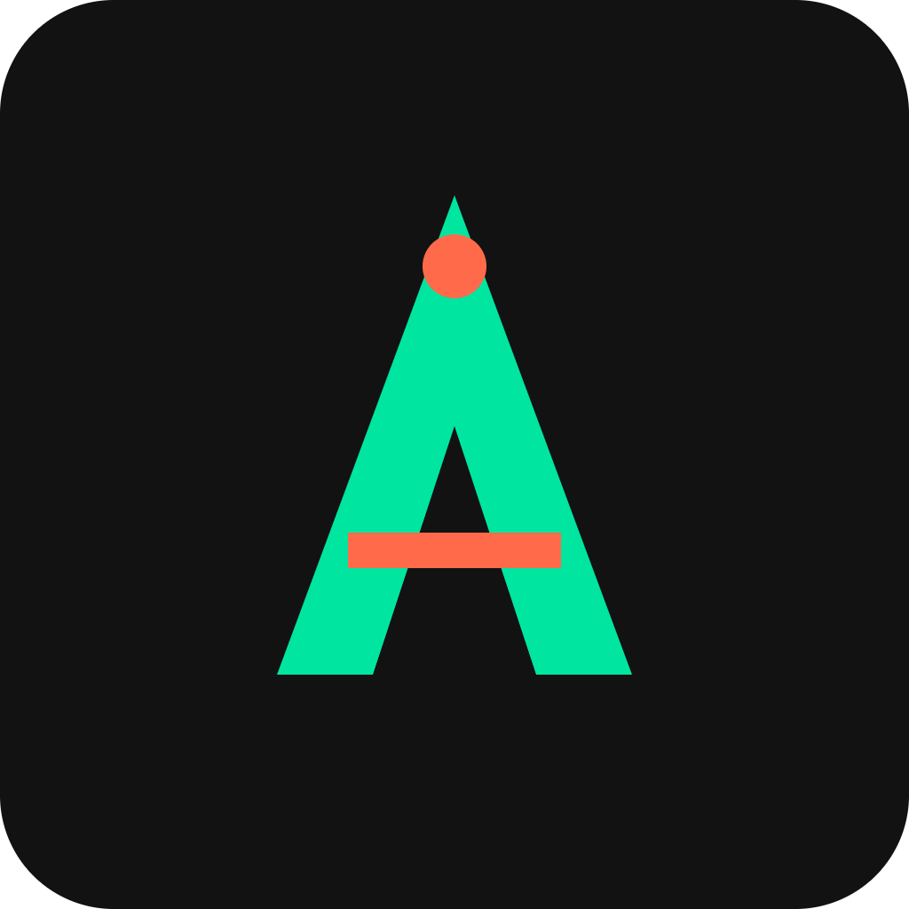

# Axon


Payment rails and escrow for autonomous AI agents transacting on Solana.

## Overview

Axon is a protocol and SDK that lets AI agents pay each other for services such as data, compute, and API calls using instant Solana micropayments. It adds built-in escrow and reputation scoring so agents can transact with each other without human intervention. A demo marketplace shows two agents negotiating and paying for a task end-to-end.

## Problem

AI agents increasingly need to transact with each other, but there is no trust-minimized, fast settlement layer built for machine-speed micropayments. Human-centric payment systems assume a person approves, disputes, or waits for settlement, which does not fit autonomous agent workflows.

## Solution

Axon provides an SDK with escrow smart contracts, an agent reputation registry, and Solana Pay-based settlement so agents can discover services, negotiate price, and pay instantly and verifiably, with no human in the loop.

## Features (MVP)

- SDK for agents to request or offer services with price quotes
- On-chain escrow program that releases funds on proof of task completion
- Reputation registry tracking each agent's success/failure rate
- Demo marketplace UI showing live agent-to-agent transactions
- Webhook/callback system for task completion verification

## Tech Stack

- Anchor + Rust (on-chain escrow and reputation programs)
- Solana Pay (settlement)
- TypeScript SDK (agent integration)
- Next.js (demo marketplace frontend)
- Helius RPC (Solana indexing/transactions)
- LangChain / agent framework integration

## How It Works

```
Agent A (buyer)            Agent B (seller)
     |                           |
  request service  ------------->|
     |<------------ price quote  |
     |                           |
  lock funds in escrow (Anchor program, Solana)
     |                           |
     |----- task performed ----->|
     |<--- completion webhook ---|
     |                           |
  escrow verifies & releases payment (Solana Pay)
     |                           |
  reputation registry updated for both agents
```

1. Agent A requests a service through the Axon SDK; Agent B returns a price quote.
2. Funds are locked in an on-chain Anchor escrow program.
3. Agent B performs the task and triggers a webhook/callback on completion.
4. The escrow program verifies completion and releases payment via Solana Pay.
5. The reputation registry records the outcome on-chain for both agents.

## Roadmap

- Integrate with popular agent frameworks (LangChain, AutoGPT, ElizaOS)
- Add dispute resolution and an insurance pool for failed tasks
- Launch a public reputation API and agent discovery marketplace

## Pitch

- Slides: [docs/pitch.pdf](docs/pitch.pdf)
- Spoken script: [docs/pitch-script.md](docs/pitch-script.md)

## Team

- Name / role — [GitHub](#) / [Twitter](#)
- Name / role — [GitHub](#) / [Twitter](#)
- Name / role — [GitHub](#) / [Twitter](#)

Built for the Colosseum hackathon (Solana).

---

🎬 Pitch video: [docs/pitch-video.mp4](docs/pitch-video.mp4)


## Prototype

Live prototype: https://nozomu-06.github.io/axon/

The source is [docs/index.html](docs/index.html) (served with GitHub Pages from the /docs folder). All data is simulated.
